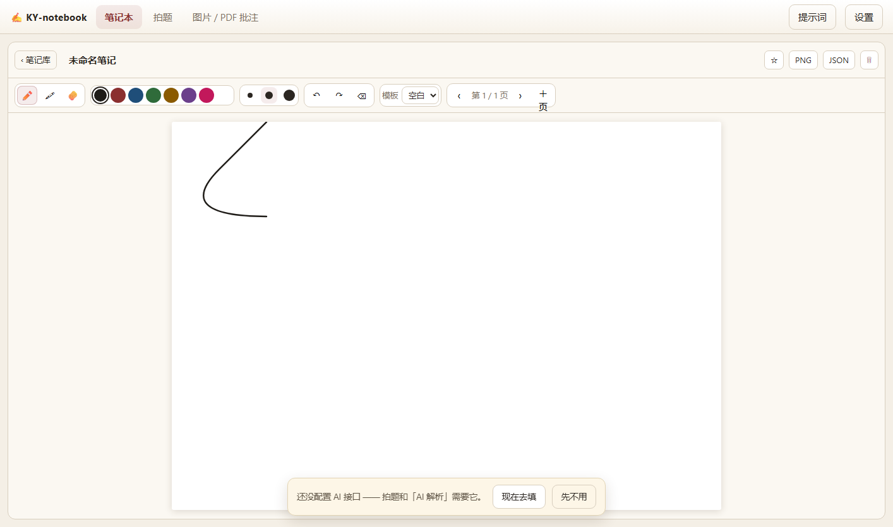
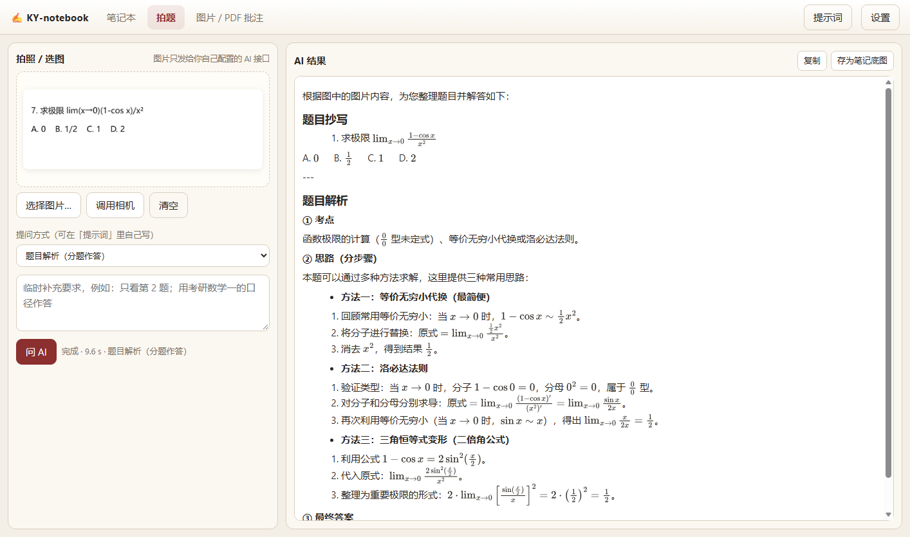

# KY-notebook

浏览器里直接用的手写笔记 / 拍题 / 图片·PDF 批注工具。纯前端，无构建步骤；AI 用你自己填的 **OpenAI 兼容接口**（可以接云端，也可以接本机 ollama），图片只发给你配置的接口。

从 KY-Toolkit 安卓壳层工程里把手写笔记、拍题、批注三条链路拆出来做成一个独立的小工具，方便单独用、单独改、单独开源。





## 三个页面

**① 笔记本**
- 手写：单 canvas 二次曲线 + 压感（粗细随按压力度变化），笔 / 荧光笔 / 橡皮
- 8 色、3 档粗细、撤销 / 重做（每页 100 步）、4 种纸面模板（空白 / 横线 / 方格 / 点阵）
- 多页：翻页、加页、每页独立笔迹，页脚显示「第 N 页 / 共 M 页」
- 笔记库：缩略图、页数、时间、收藏 ★、删除 ✕、点标题就地改名
- 导出 PNG（2× 分辨率）/ JSON（仅导出，留着做备份），自动保存（700ms 防抖）到 IndexedDB

**② 拍题**
- 拍照（getUserMedia，失败回退文件选择）/ 选择图片 / 拖拽图片进来
- 选一个提示词，或临时补充要求，然后「问 AI」
- 结果按 Markdown 渲染，公式走 MathJax
- 「存为笔记底图」把这张题图铺进一张新笔记，直接在题面上写过程

**③ 图片 / PDF 批注**
- 导入图片或 PDF（pdf.js 渲染每页成底图），逐页手写批注
- 缩放、翻页、导出 PNG / JSON
- 「让 AI 解析本页」用同一套提示词解析当前页

**提示词**（点右上角「提示词」）
- 内置 6 条：题目解析（分题作答）• 只抄题（不解答）• 公式 → LaTeX • 整页翻译（一句原文一句译文）• 整页结构化 • 自定义
- 每条 = 名字 + 系统提示（可选）+ 要求；可以新建、编辑、恢复默认
- 三个页面共用同一份，拍题页和批注页都能选

## 快速开始

```bash
cd KY-notebook
python serve.py            # 默认 http://127.0.0.1:8765/
# 或换端口： python serve.py 9000
```

然后浏览器打开 `http://127.0.0.1:8765/`，点右上角「设置」填接口。

**为什么不能直接双击 index.html**：一是用了 ES module，`file://` 下会被拦；二是浏览器直连第三方 AI 接口时，如果对方没给 CORS 头，fetch 会失败——`serve.py` 内置了一个同源代理（`POST /proxy?u=<目标地址>`），页面直连被拦时会自动改走它，所以你只需要跑这一个命令。

## 配置 AI

| 字段 | 说明 |
|---|---|
| Base URL | `https://xxx/v1`、`…/v1/chat/completions`、ollama 的 `http://127.0.0.1:11434` 都行，会自动补 `/chat/completions` |
| API Key | 本机 ollama 可以留空 |
| 模型 | 例如 `gpt-4o-mini`、`qwen2.5-vl-7b`、`deepseek-v4.1-flash` 等 |
| 支持看图 | 拍题、图片/PDF 解析必须勾上，并且模型本身得是视觉模型 |

几个坑：

- **推理型模型会先花 token 思考**。如果报「模型输出被 max_tokens 截断」，把 `src/shot.js`、`src/annot.js` 里的 `maxTokens` 调大（当前 3000）。
- **CORS**：直连被拦时自动走 `/proxy`，所以 `serve.py` 必须用这个而不是 `http.server`；接口如果在本机（如 ollama）通常直连就通。
- **OpenCode Go**（`https://opencode.ai/zen/go/v1`）：需要 `x-opencode-session` 头，代码在目标地址含 `opencode.ai` 时会自动加。

## 数据存在哪

- 笔记与页面：IndexedDB `kynb`（`notes` / `pages` 两个 store），清浏览器站点数据就没了
- 配置：localStorage `kynb_ai`
- 提示词：localStorage `kynb_prompts`

## 目录

```
index.html        三个页面 + 设置/提示词对话框
serve.py          静态服务 + /proxy CORS 代理（无第三方依赖）
src/ai.js         OpenAI 兼容适配（含代理回退、会话头、错误提示）
src/prompts.js    提示词的读写与默认值
src/md.js         Markdown → DOM + MathJax 排版 + 输出清洗
src/store.js      IndexedDB 封装
src/inkboard.js   手写引擎（页面坐标 1414×1000、二次曲线、压感、撤销、导出）
src/notebook.js   笔记库 + 编辑器
src/shot.js       拍题
src/annot.js      图片 / PDF 批注
src/main.js       标签切换、设置与提示词对话框
docs/screenshots/ 截图
```

## 已知限制

- 拍题和图片解析依赖**视觉模型**；模型不支持看图时会明确报错，不会静默失败。
- PDF 目前只做「渲染成图 + 手写批注」，不从 PDF 里抽文字；想要「左原文右译文」那种效果需要再加文字层 + 公式 OCR（KY-Toolkit 里是另一条链路）。
- 没有云同步 / 多人协作；导出只有 PNG 和 JSON，**JSON 目前只能导出、不能导回**。
- 批注页导出的 JSON 只含笔迹和页码，不含底图（图片 / PDF 原图）；要连底图一起留，请导出 PNG。
- 窄屏（≤760px）下三个页面改成单列堆叠、整页滚动，手写画布会跟着缩小；桌面 / 平板横屏才是主要使用形态。
- MathJax、pdf.js 走 CDN，要完全离线得自己换成本地文件。

## 许可

MIT。参考过的实现：perfect-freehand（压感轮廓思路）、pdf.js（Apache-2.0）、MathJax（Apache-2.0）。
